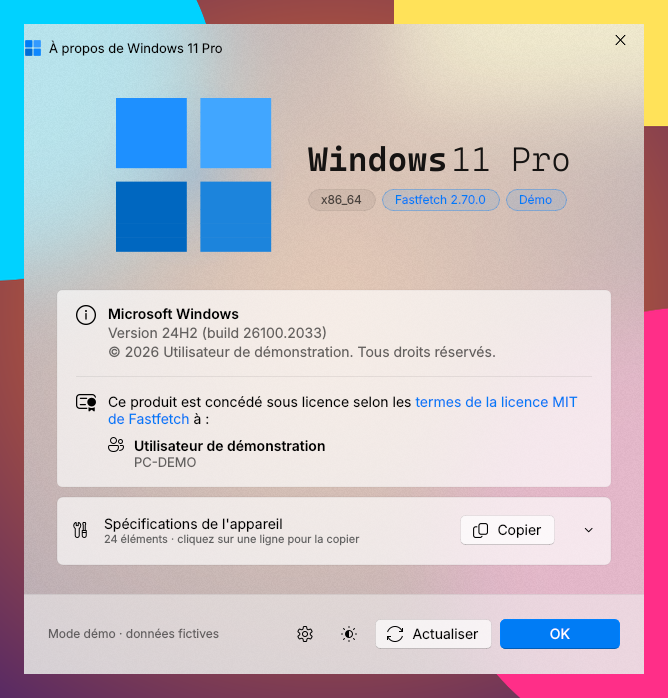
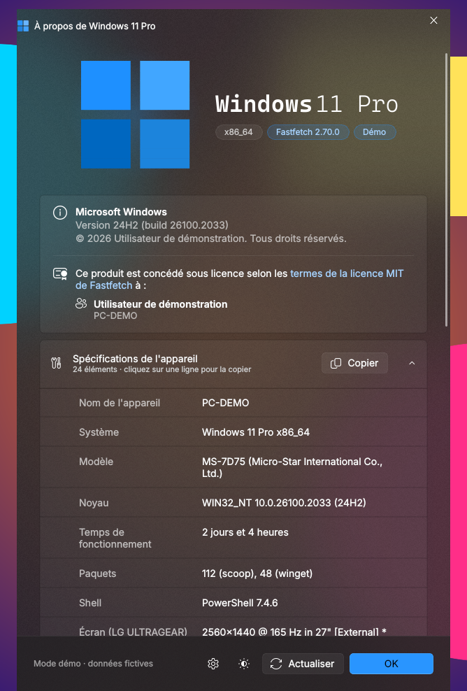
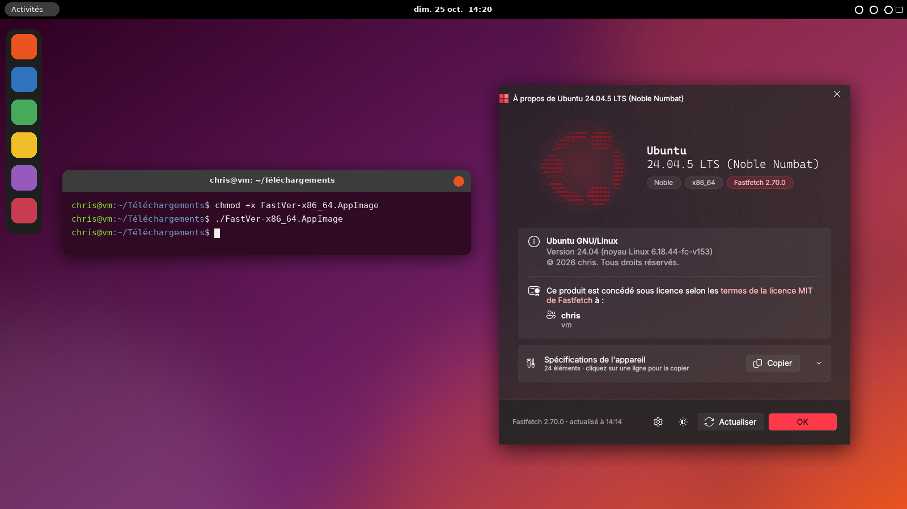
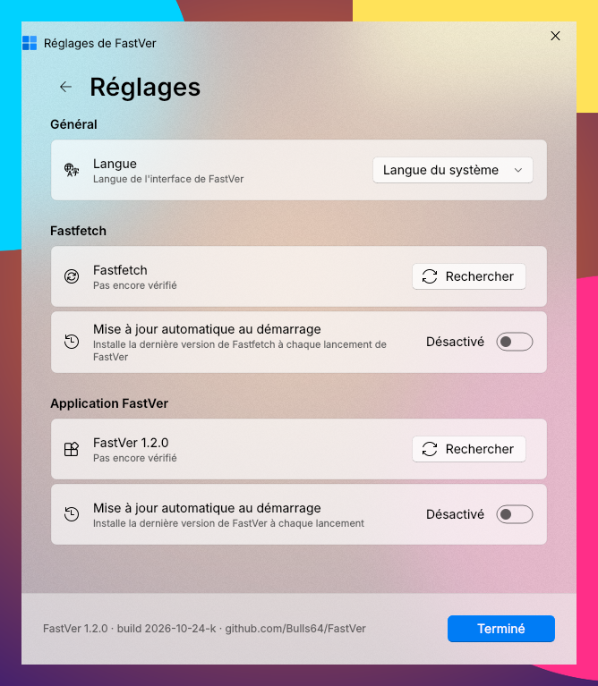

# FastVer

Une fenêtre « À propos » pour [Fastfetch](https://github.com/fastfetch-cli/fastfetch), inspirée de Winver (Windows 11) et dessinée avec les composants Fluent de WinUI 3 (PySide6 + QFluentWidgets).

*English version below: [English](#english).*

  
  

Thème clair et thème sombre avec les spécifications dépliées (mode démo : <code>--demo</code>).

  

FastVer sous Ubuntu 24.04 LTS (AppImage, Fastfetch 2.70.0). Capture réelle de la fenêtre ; le décor du bureau est une illustration.

## Installation

- **Windows :** téléchargez `FastVer.exe` depuis la [dernière version](../../releases/latest). Fastfetch doit être installé (`winget install Fastfetch-cli.Fastfetch`).
- **Linux :** téléchargez `FastVer-x86_64.AppImage`, rendez-le exécutable (`chmod +x FastVer-x86_64.AppImage`) et lancez-le. Il embarque Python et Qt ; il faut seulement Fastfetch et une distribution avec glibc 2.34 ou plus (Ubuntu 22.04, Debian 12, Fedora 35, RHEL 9 et plus récentes). Si FUSE manque : `./FastVer-x86_64.AppImage --appimage-extract-and-run`.
- **Script :** `pip install PySide6-Fluent-Widgets`, puis `python fastver.py`.

L'exe n'est pas signé : au premier lancement, SmartScreen demande une confirmation (« Informations complémentaires » → « Exécuter quand même »).

## Mises à jour

  

FastVer peut se mettre à jour lui-même depuis les releases de ce dépôt (Réglages → Application FastVer). Chaque fichier est vérifié avant d'être installé : son empreinte SHA-256 doit correspondre à celle publiée dans le fichier `.sha256` qui l'accompagne et à celle que GitHub calcule pour l'asset. Sans empreinte, ou si elles se contredisent, la mise à jour est refusée.

## Publier une version

1. Changer `APP_VERSION` et `BUILD` dans `fastver.py`.
2. `git tag v1.2.0 && git push origin v1.2.0`

Le workflow `.github/workflows/release.yml` compile alors l'exe sur Windows et l'AppImage sur Ubuntu 22.04, lance leur autotest (`--selftest`), calcule les empreintes et publie la release avec `FastVer.exe`, `FastVer-x86_64.AppImage`, `fastver.py`, leurs `.sha256` et `SHA256SUMS`.

Compilation locale (dépendances) : `pip install -r requirements-build.txt`, puis `pip install --no-deps -r requirements-nodeps.txt`.

- **Exe :** `python tools/make_version_info.py`, puis `python -m PyInstaller --noconfirm --clean FastVer.spec`.
- **AppImage :** `bash tools/build_appimage.sh` (binutils requis ; appimagetool est téléchargé s'il manque).

## Licence

FastVer embarque [QFluentWidgets](https://pypi.org/project/pyside6-fluent-widgets), publié sous GPLv3 pour un usage non commercial. FastVer doit donc être distribué sous une licence compatible (GPLv3) avec ses sources.

---

# FastVer (English)

An “About” window for [Fastfetch](https://github.com/fastfetch-cli/fastfetch), inspired by Windows 11's Winver and drawn with WinUI 3 Fluent components (PySide6 + QFluentWidgets). The interface is available in French and English (Settings → Language, or `--lang en`).

The screenshots above show, in order: the light theme, the dark theme with the device specifications expanded (demo mode: `--demo`), and FastVer on Ubuntu 24.04 LTS (AppImage, Fastfetch 2.70.0; the window is a real capture, the desktop around it is an illustration).

## Installation

- **Windows:** download `FastVer.exe` from the [latest release](../../releases/latest). Fastfetch must be installed (`winget install Fastfetch-cli.Fastfetch`).
- **Linux:** download `FastVer-x86_64.AppImage`, make it executable (`chmod +x FastVer-x86_64.AppImage`) and run it. It bundles Python and Qt; all you need is Fastfetch and a distribution with glibc 2.34 or later (Ubuntu 22.04, Debian 12, Fedora 35, RHEL 9 and newer). If FUSE is missing: `./FastVer-x86_64.AppImage --appimage-extract-and-run`.
- **Script:** `pip install PySide6-Fluent-Widgets`, then `python fastver.py`.

The exe is not signed: on first launch, SmartScreen asks for confirmation (“More info” → “Run anyway”).

## Updates

FastVer can update itself from this repository's releases (Settings → FastVer app). Every file is checked before it is installed: its SHA-256 hash must match the one published in the `.sha256` file that comes with it and the one GitHub computes for the asset. If there is no hash, or if they disagree, the update is refused.

## Publishing a release

1. Change `APP_VERSION` and `BUILD` in `fastver.py`.
2. `git tag v1.2.0 && git push origin v1.2.0`

The `.github/workflows/release.yml` workflow then builds the exe on Windows and the AppImage on Ubuntu 22.04, runs their self-test (`--selftest`), computes the hashes and publishes the release with `FastVer.exe`, `FastVer-x86_64.AppImage`, `fastver.py`, their `.sha256` files and `SHA256SUMS`.

Local build (dependencies): `pip install -r requirements-build.txt`, then `pip install --no-deps -r requirements-nodeps.txt`.

- **Exe:** `python tools/make_version_info.py`, then `python -m PyInstaller --noconfirm --clean FastVer.spec`.
- **AppImage:** `bash tools/build_appimage.sh` (binutils required; appimagetool is downloaded if missing).

## License

FastVer bundles [QFluentWidgets](https://pypi.org/project/pyside6-fluent-widgets), released under GPLv3 for non-commercial use. FastVer must therefore be distributed under a compatible license (GPLv3), together with its source code.
