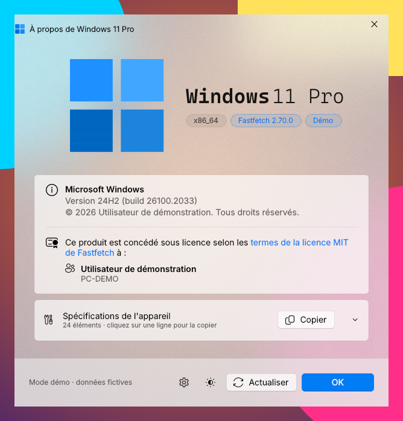
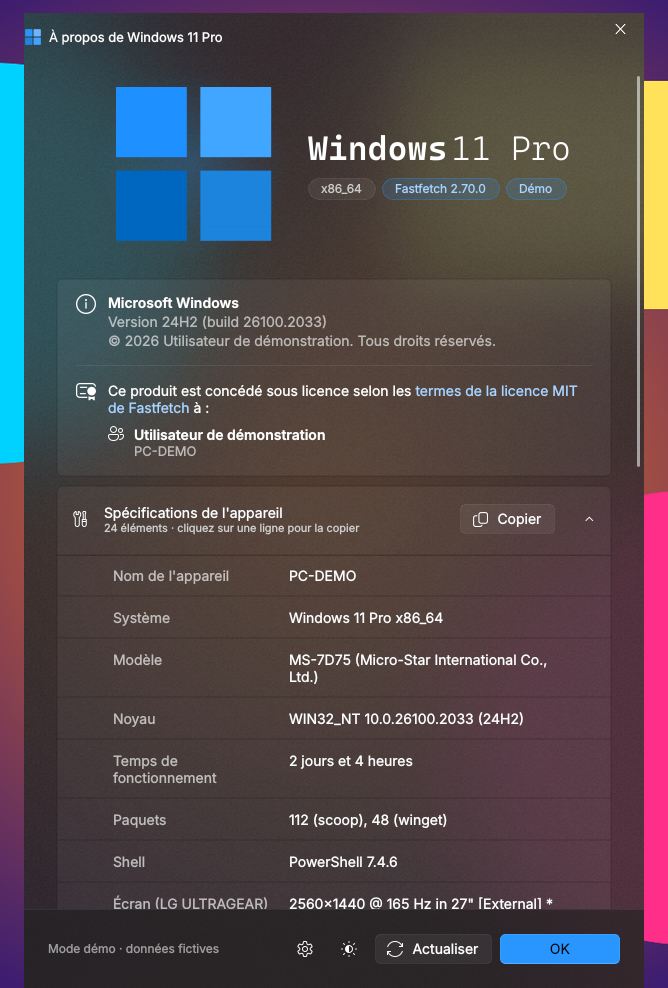
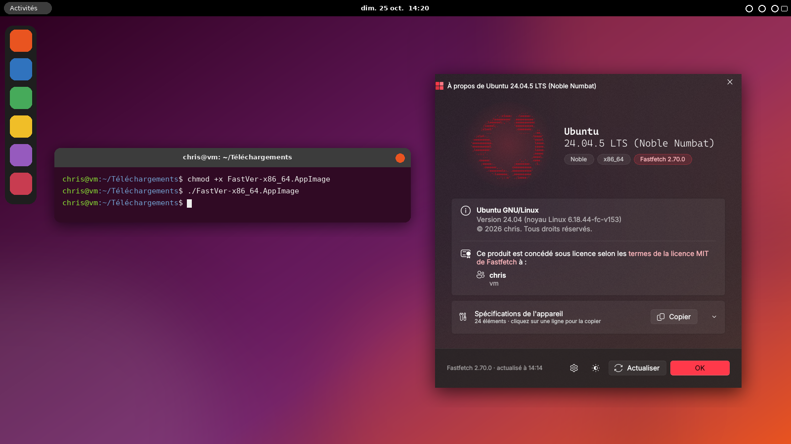
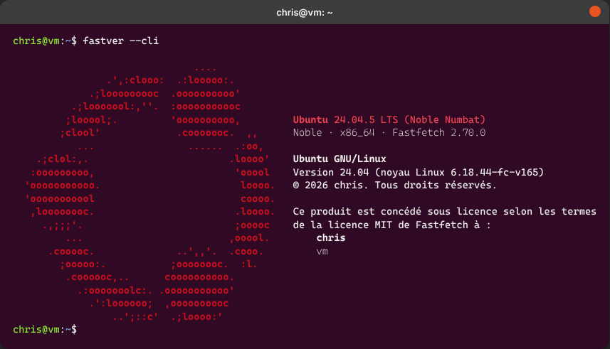
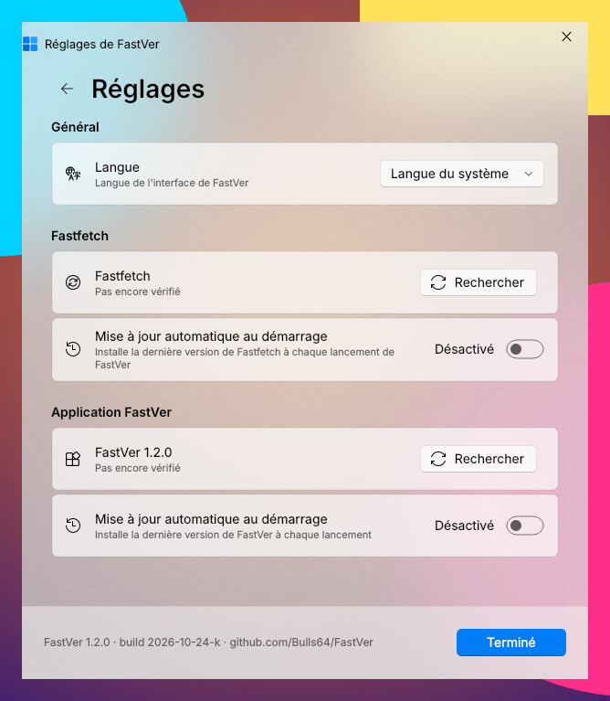

# FastVer

Une fenêtre « À propos » pour [Fastfetch](https://github.com/fastfetch-cli/fastfetch), inspirée de Winver (Windows 11) et dessinée avec les composants Fluent de WinUI 3 (PySide6 + QFluentWidgets).

*English version below: [English](#english).*

<p align="center">
  
  
</p>
<p align="center"><sub>Thème clair et thème sombre avec les spécifications dépliées (mode démo : <code>--demo</code>).</sub></p>

<p align="center">
  
</p>
<p align="center"><sub>FastVer sous Ubuntu 24.04 LTS (AppImage, Fastfetch 2.70.0). Capture réelle de la fenêtre ; le décor du bureau est une illustration.</sub></p>

## Installation

- **Windows :** téléchargez `FastVer.exe` depuis la [dernière version](../../releases/latest) (ou `FastVer-cli.exe` pour la version en ligne de commande). Fastfetch doit être installé (`winget install Fastfetch-cli.Fastfetch`).
- **Linux :** téléchargez `FastVer-x86_64.AppImage`, rendez-le exécutable (`chmod +x FastVer-x86_64.AppImage`) et lancez-le. Il embarque Python et Qt ; il faut seulement Fastfetch et une distribution avec glibc 2.34 ou plus (Ubuntu 22.04, Debian 12, Fedora 35, RHEL 9 et plus récentes). Si FUSE manque : `./FastVer-x86_64.AppImage --appimage-extract-and-run`.
- **Debian, Ubuntu et dérivées :** téléchargez `fastver_<version>_amd64.deb` et installez-le avec `sudo apt install ./fastver_<version>_amd64.deb` (Debian 12, Ubuntu 22.04 et plus récentes). FastVer apparaît dans le menu des applications ; les commandes `fastver` et `fastver-cli` sont ajoutées. Désinstallation : `sudo apt remove fastver`.
- **Fedora, RHEL et dérivées (Rocky, Alma), openSUSE :** téléchargez `fastver-<version>-1.x86_64.rpm` et installez-le avec `sudo dnf install ./fastver-<version>-1.x86_64.rpm` (ou `sudo zypper install --allow-unsigned-rpm ./fastver-<version>-1.x86_64.rpm` sous openSUSE). Mêmes commandes et même entrée de menu que le .deb. Désinstallation : `sudo dnf remove fastver` ou `sudo zypper remove fastver`.
- **Arch Linux et dérivées (AUR) :** la recette `fastver-bin` est dans [`packaging/aur`](packaging/aur). Une fois publiée sur l'AUR : `yay -S fastver-bin` (ou `paru -S fastver-bin`). En attendant, ou sans assistant : `git clone https://github.com/Bulls64/FastVer && cd FastVer/packaging/aur && makepkg -si`.
- **Script :** `pip install PySide6-Fluent-Widgets`, puis `python fastver.py`.

L'exe n'est pas signé : au premier lancement, SmartScreen demande une confirmation (« Informations complémentaires » → « Exécuter quand même »).

## Version en ligne de commande

<p align="center">
  
</p>

`fastver --cli` affiche la même fiche dans le terminal, sans fenêtre : logo en couleur, système, version, licence. Elle ne demande ni Qt ni QFluentWidgets : `python fastver.py --cli` marche avec un Python seul.

- **Windows :** `FastVer-cli.exe` (exe console, environ 9 Mo) démarre directement dans ce mode. `FastVer.exe --cli` marche aussi depuis une invite de commandes.
- **Linux :** `fastver-cli` avec le paquet .deb, .rpm ou AUR, `./FastVer-x86_64.AppImage --cli`, ou un lien nommé `fastver-cli` vers l'AppImage ou vers `fastver.py`.

| Option | Effet |
| --- | --- |
| `-s`, `--specs` | ajoute les spécifications de l'appareil, avec des jauges pour la mémoire et les disques |
| `--json` | sortie JSON, pour les scripts |
| `--check` | recherche les mises à jour de Fastfetch et de FastVer |
| `--update fastfetch\|fastver\|all` | installe les mises à jour (même vérification SHA-256 que la fenêtre) |
| `--backups`, `--delete-backups` | liste ou supprime les anciennes versions gardées (avec confirmation, ou `-y`) |
| `--no-color`, `--no-logo` | sans couleurs ni liens, sans logo (couleurs coupées aussi par `NO_COLOR` ou une sortie redirigée) |
| `--demo`, `--fastfetch CHEMIN`, `--lang fr\|en` | comme pour la fenêtre |

## Mises à jour

<p align="center">
  
</p>

FastVer peut se mettre à jour lui-même depuis les releases de ce dépôt (Réglages → Application FastVer). Chaque fichier est vérifié avant d'être installé : son empreinte SHA-256 doit correspondre à celle publiée dans le fichier `.sha256` qui l'accompagne et à celle que GitHub calcule pour l'asset. Sans empreinte, ou si elles se contredisent, la mise à jour est refusée. Installé par le paquet .deb, .rpm ou AUR, FastVer ne touche pas à ses fichiers : il signale la nouvelle version et ouvre sa page, et la mise à jour se fait en installant le nouveau paquet.

Depuis la 1.4.2, chaque fichier publié porte aussi une attestation de provenance signée par GitHub (Sigstore) : elle prouve qu'il a été compilé par le workflow de ce dépôt, à partir du commit du tag. Pour la vérifier avec [GitHub CLI](https://cli.github.com) :

```
gh attestation verify FastVer.exe --repo Bulls64/FastVer
```

## Publier une version

1. Changer `APP_VERSION` et `BUILD` dans `fastver.py`.
2. `git tag v1.2.0 && git push origin v1.2.0`

Le workflow `.github/workflows/release.yml` compile alors les deux exe sur Windows et l'AppImage et les paquets .deb et .rpm sur Ubuntu 22.04, les teste (le .rpm dans des conteneurs Fedora, Rocky Linux 9 et openSUSE, la recette AUR dans un conteneur Arch Linux) (`--selftest` pour la fenêtre, `--demo` et `--json` pour la version CLI), calcule les empreintes et publie la release avec `FastVer.exe`, `FastVer-cli.exe`, `FastVer-x86_64.AppImage`, `fastver_<version>_amd64.deb`, `fastver-<version>-1.x86_64.rpm`, `fastver.py`, leurs `.sha256` et `SHA256SUMS`.

Compilation locale (dépendances) : `pip install -r requirements-build.txt`, puis `pip install --no-deps -r requirements-nodeps.txt`.

- **Exe :** `python tools/make_version_info.py`, puis `python -m PyInstaller --noconfirm --clean FastVer.spec` (et `FastVer-cli.spec` pour la version CLI).
- **AppImage :** `bash tools/build_appimage.sh` (binutils requis ; appimagetool est téléchargé s'il manque).
- **Paquet .deb :** `bash tools/build_deb.sh`, après l'AppImage (il reprend son dossier `build/FastVer.AppDir`).
- **Paquet .rpm :** `bash tools/build_rpm.sh`, de même (rpmbuild requis : paquet `rpm` sous Debian et Ubuntu, `rpm-build` sous Fedora).
- **Recette AUR :** après chaque release, `bash tools/update_aur.sh <version>` met `packaging/aur` à jour (version, empreinte de l'AppImage, `.SRCINFO`) ; il reste à pousser `PKGBUILD` et `.SRCINFO` sur le dépôt AUR `fastver-bin` (instructions en tête du script).

## Licence

FastVer embarque [QFluentWidgets](https://pypi.org/project/pyside6-fluent-widgets), publié sous GPLv3 pour un usage non commercial. FastVer doit donc être distribué sous une licence compatible (GPLv3) avec ses sources.

---

<a id="english"></a>

# FastVer (English)

An “About” window for [Fastfetch](https://github.com/fastfetch-cli/fastfetch), inspired by Windows 11's Winver and drawn with WinUI 3 Fluent components (PySide6 + QFluentWidgets). The interface is available in French and English (Settings → Language, or `--lang en`).

The screenshots above show, in order: the light theme, the dark theme with the device specifications expanded (demo mode: `--demo`), and FastVer on Ubuntu 24.04 LTS (AppImage, Fastfetch 2.70.0; the window is a real capture, the desktop around it is an illustration).

## Installation

- **Windows:** download `FastVer.exe` from the [latest release](../../releases/latest) (or `FastVer-cli.exe` for the command-line version). Fastfetch must be installed (`winget install Fastfetch-cli.Fastfetch`).
- **Linux:** download `FastVer-x86_64.AppImage`, make it executable (`chmod +x FastVer-x86_64.AppImage`) and run it. It bundles Python and Qt; all you need is Fastfetch and a distribution with glibc 2.34 or later (Ubuntu 22.04, Debian 12, Fedora 35, RHEL 9 and newer). If FUSE is missing: `./FastVer-x86_64.AppImage --appimage-extract-and-run`.
- **Debian, Ubuntu and derivatives:** download `fastver_<version>_amd64.deb` and install it with `sudo apt install ./fastver_<version>_amd64.deb` (Debian 12, Ubuntu 22.04 and newer). FastVer shows up in the applications menu; the `fastver` and `fastver-cli` commands are added. To uninstall: `sudo apt remove fastver`.
- **Fedora, RHEL and derivatives (Rocky, Alma), openSUSE:** download `fastver-<version>-1.x86_64.rpm` and install it with `sudo dnf install ./fastver-<version>-1.x86_64.rpm` (or `sudo zypper install --allow-unsigned-rpm ./fastver-<version>-1.x86_64.rpm` on openSUSE). Same commands and menu entry as the .deb. To uninstall: `sudo dnf remove fastver` or `sudo zypper remove fastver`.
- **Arch Linux and derivatives (AUR):** the `fastver-bin` recipe lives in [`packaging/aur`](packaging/aur). Once it is on the AUR: `yay -S fastver-bin` (or `paru -S fastver-bin`). Until then, or without a helper: `git clone https://github.com/Bulls64/FastVer && cd FastVer/packaging/aur && makepkg -si`.
- **Script:** `pip install PySide6-Fluent-Widgets`, then `python fastver.py`.

The exe is not signed: on first launch, SmartScreen asks for confirmation (“More info” → “Run anyway”).

## Command-line version

`fastver --cli` shows the same card in the terminal, without a window (screenshot above, in the French section): colored logo, system, version, license. It needs neither Qt nor QFluentWidgets: `python fastver.py --cli` works with plain Python.

- **Windows:** `FastVer-cli.exe` (console exe, about 9 MB) starts directly in this mode. `FastVer.exe --cli` also works from a command prompt.
- **Linux:** `fastver-cli` with the .deb, .rpm or AUR package, `./FastVer-x86_64.AppImage --cli`, or a link named `fastver-cli` to the AppImage or to `fastver.py`.

| Option | Effect |
| --- | --- |
| `-s`, `--specs` | adds the device specifications, with gauges for memory and disks |
| `--json` | JSON output, for scripts |
| `--check` | checks for Fastfetch and FastVer updates |
| `--update fastfetch\|fastver\|all` | installs the updates (same SHA-256 check as the window) |
| `--backups`, `--delete-backups` | lists or deletes the old versions kept (with confirmation, or `-y`) |
| `--no-color`, `--no-logo` | no colors or links, no logo (colors are also turned off by `NO_COLOR` or redirected output) |
| `--demo`, `--fastfetch PATH`, `--lang fr\|en` | as for the window |

## Updates

FastVer can update itself from this repository's releases (Settings → FastVer app). Every file is checked before it is installed: its SHA-256 hash must match the one published in the `.sha256` file that comes with it and the one GitHub computes for the asset. If there is no hash, or if they disagree, the update is refused. Installed from the .deb, .rpm or AUR package, FastVer leaves its files alone: it reports the new version and opens its page, and you update by installing the new package.

Since 1.4.2, every released file also carries a GitHub-signed provenance attestation (Sigstore): it proves the file was built by this repository's workflow, from the tagged commit. To check it with [GitHub CLI](https://cli.github.com):

```
gh attestation verify FastVer.exe --repo Bulls64/FastVer
```

## Publishing a release

1. Change `APP_VERSION` and `BUILD` in `fastver.py`.
2. `git tag v1.2.0 && git push origin v1.2.0`

The `.github/workflows/release.yml` workflow then builds both exes on Windows and the AppImage and .deb and .rpm packages on Ubuntu 22.04, tests them (the .rpm in Fedora, Rocky Linux 9 and openSUSE containers, the AUR recipe in an Arch Linux container) (`--selftest` for the window, `--demo` and `--json` for the CLI version), computes the hashes and publishes the release with `FastVer.exe`, `FastVer-cli.exe`, `FastVer-x86_64.AppImage`, `fastver_<version>_amd64.deb`, `fastver-<version>-1.x86_64.rpm`, `fastver.py`, their `.sha256` files and `SHA256SUMS`.

Local build (dependencies): `pip install -r requirements-build.txt`, then `pip install --no-deps -r requirements-nodeps.txt`.

- **Exe:** `python tools/make_version_info.py`, then `python -m PyInstaller --noconfirm --clean FastVer.spec` (and `FastVer-cli.spec` for the CLI version).
- **AppImage:** `bash tools/build_appimage.sh` (binutils required; appimagetool is downloaded if missing).
- **.deb package:** `bash tools/build_deb.sh`, after the AppImage (it reuses its `build/FastVer.AppDir` folder).
- **.rpm package:** `bash tools/build_rpm.sh`, likewise (rpmbuild required: `rpm` package on Debian and Ubuntu, `rpm-build` on Fedora).
- **AUR recipe:** after each release, `bash tools/update_aur.sh <version>` updates `packaging/aur` (version, AppImage checksum, `.SRCINFO`); then push `PKGBUILD` and `.SRCINFO` to the `fastver-bin` AUR repository (instructions at the top of the script).

## License

FastVer bundles [QFluentWidgets](https://pypi.org/project/pyside6-fluent-widgets), released under GPLv3 for non-commercial use. FastVer must therefore be distributed under a compatible license (GPLv3), together with its source code.
